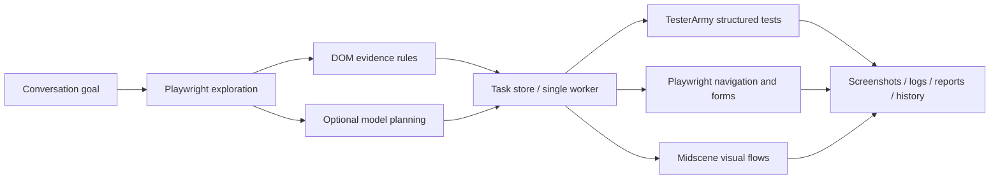

# Xunce

**English** | [简体中文](README.md)

A conversational E2E testing platform that explores web apps, discovers test tasks, and runs verifiable tests. Xunce combines TesterArmy E2E, Playwright, and Midscene.js with a web console for managing tasks and inspecting evidence.

The current workflow is **describe a goal → explore same-origin pages → discover tasks → run assertions → inspect screenshots and reports → rerun failures**. A built-in demo store includes an intentional HTTP 500 page so you can verify failure detection without configuring a model.

The web console is currently in Chinese. This guide includes the original labels where they help you find an action.


## Get the code

```bash
git clone https://github.com/caoyanyi/xunce.git
cd xunce
```

## Build and deploy with Docker

With Docker and a recent Docker Compose installed, run:

```bash
docker compose up -d --build
```

Open **http://127.0.0.1:4318**, or **`http://<server-ip>:4318`** from another device. Click **Try the demo store** (`试运行演示商城`). No model API key is required for the demo.

The service binds to `0.0.0.0` and accepts requests through any IP address or hostname. Write requests retain same-origin checks, including HTTP/HTTPS origins behind a reverse proxy. The image builds both the frontend and backend, then runs the compiled JavaScript with Node.js 24, Chromium, and Chinese fonts. The host does not need Node.js, a browser, or `node_modules`.

Compose persists `/app/data` in the named volume **`e2e-explorer_explorer-data`**. It stores SQLite records, screenshots, traces, and reports. The container runs as the non-root `node` user; a fresh deployment does not require creating host data directories or changing their permissions.

```bash
# Inspect service status and logs.
docker compose ps
docker compose logs -f explorer

# Verify the running container with real browser tests and failure evidence.
# This creates a separate test session and does not call a model.
docker compose exec explorer npm run test:docker

# Rebuild and deploy after updating the source.
docker compose up -d --build

# Stop the service while keeping its data volume.
docker compose down
```

To publish a different host port, such as **8080**:

```bash
HTTP_PORT=8080 docker compose up -d --build
```

You can also set `HTTP_PORT=8080` in `.env`. The container keeps its internal port at 4318. The smoke check creates three execution records: two passing checks and one intentional HTTP 500 failure. If Node.js is installed on the host, you can also run it against a published port:

```bash
SMOKE_URL=http://127.0.0.1:8080 npm run test:docker
```

An existing `.env` is injected at runtime; configuration secrets and execution data are excluded from the image. The demo also works without `.env`. Build arguments `NODE_IMAGE`, `NPM_REGISTRY`, and `DEBIAN_MIRROR` configure the base image and dependency mirrors. The default Debian mirror is `mirrors.aliyun.com`; Debian package signature verification remains enabled.

Test browsers run **inside the container**. Use `http://host.docker.internal:<app-port>` or the host's LAN IP to reach an application on the host, and service names to reach other Compose services. The built-in store uses the server's own loopback address, so its default TesterArmy tests work when the console is accessed remotely. For other plain HTTP targets, see the execution-engine limitation below.

### Migrate an existing local workspace

For a first migration from `./data`, stop the native `npm start` service and use an **empty** destination volume:

```bash
docker compose build
docker compose create explorer
docker compose run --rm --no-deps -v "$(pwd)/data:/source:ro" explorer \
  node -e "require('node:fs').cpSync('/source','/app/data',{recursive:true})"
docker compose up -d
```

The original `./data` is unchanged. Subsequent container runs write to the named volume.

### Use Docker without Compose

```bash
docker build -t e2e-explorer:local .
docker run -d --init --name e2e-explorer \
  -p 4318:4318 --shm-size=1g \
  -v e2e-explorer-data:/app/data \
  --add-host=host.docker.internal:host-gateway \
  e2e-explorer:local
```

## Run from source

Requires **Node.js 24.8+**.

```bash
npm ci
npm run browsers:install
npm run dev
```

Open **http://127.0.0.1:5173**. If a supported system Chromium is already installed, Xunce detects it automatically and you can skip browser installation. Set `CHROMIUM_PATH` in `.env` to use a specific executable.

To build the application and serve the console and API on one port:

```bash
npm run build
npm start
```

Open **http://127.0.0.1:4318**, or **`http://<server-ip>:4318`** from another device. Set `HOST` and `PORT` in `.env` to change the native server binding. Use `HOST=127.0.0.1` to restrict native access to the local machine. The development proxy reads the same port configuration. After building, `npm run start:production` runs the compiled backend directly.

## Features

| Capability                 | Current behavior                                                                                                            |
| -------------------------- | --------------------------------------------------------------------------------------------------------------------------- |
| Conversational entry point | Start exploration, discover tasks, run tests, check progress, stop work, and retry failures.                                |
| Autonomous discovery       | Same-origin breadth-first exploration with Playwright, extracting actual pages, links, and forms within page/depth budgets. |
| Deterministic checks       | HTTP status, page title and body content, actual same-origin link navigation, and native required-field constraints.        |
| Business-flow planning     | An optional OpenAI-compatible model plans structured visual tasks from page observations and user goals.                    |
| Structured execution       | TesterArmy's official `e2e/runner` executes TypeScript tests generated from a fixed template, without model calls.          |
| Visual execution           | Midscene `PlaywrightAgent.aiAct` and `aiAssert`, enabled after configuring a vision model.                                  |
| Playwright baseline        | Direct Playwright execution for navigation and form-constraint tasks.                                                       |
| Task management            | Priority, source, engine, status, search, filters, and individual/all/failed-task execution.                                |
| Evidence                   | Screenshots, step logs, traces, raw reports, and generated TesterArmy test files.                                           |
| History and recovery       | SQLite persistence, separate records for reruns, and interrupted-run recovery after a restart.                              |
| Web console                | Chinese-language UI with conversation, page lists, task details, run history, JSON export, and a mobile layout.             |
| HTTP API                   | Core console operations are also available through the API for CLI, CI, or agent integrations.                              |

Without model configuration, Xunce explicitly uses **DOM-based rules** to discover basic tests. Complex business-flow planning requires both the planner and vision-model configurations.

### Conversation and controls

Set a target in the URL field or include a complete URL in your message, for example:

```text
Explore http://localhost:3000 and check its pages and login form, then run the tests.
```

The current command router recognizes these commands:

| Goal                              | Command                                             |
| --------------------------------- | --------------------------------------------------- |
| Explore without running tasks     | `discover only`                                     |
| Run existing tasks                | `运行全部任务` (or the `运行全部` / Run all button) |
| Check progress                    | `status` or `progress`                              |
| Stop the current operation        | `stop` or `cancel`                                  |
| Rerun failed or interrupted tasks | `retry` or `rerun`                                  |
| List failures                     | `查看失败任务`                                      |
| Show command help                 | `help`                                              |

General goals start exploration and automatic execution. Once a session has tasks, create a new session to change its target. The default budget is **6 pages** and **depth 2**; adjust it under **Exploration settings** (`探索设置`).

## Workspace upgrades in 0.2

- **Plan before execution:** use discovery-only or replan. Replanning reuses observed pages when available, archives obsolete generated tasks, and preserves manual/customized tasks.
- **Edit test assets:** create tasks and edit URLs, assertions, selectors, visual instructions, or step order. Runs retain the task revision and definition they actually used.
- **Select and organize:** run selected tasks, disable unwanted cases, or archive and restore them through the archived filter. History is retained.
- **Queue and continue:** sessions enter a FIFO queue with one unfinished job per session and at most 20 waiting jobs. Cancel queued work without stopping another session. Continue selects pending/cancelled tasks; interrupted tasks restart from their first step. Retry selects failed/cancelled tasks.
- **Save settings separately:** persist the session name, target, and options without sending a new conversation. Control commands do not replace the session name or testing goal.
- **Understand results:** view per-job progress, current steps, queue position, job history, failed steps, and recovery advice. A failed model plan is explicitly identified as basic checks only. Informational questions start neither browsers nor model calls.

Interactive drafts can be saved in read-only sessions; execution still requires writable interaction. Permission, model, and engine checks run before a job is created. Generated tasks for non-loopback HTTP targets select Playwright with an explanation; edit existing incompatible cases to change their engine.

[Task editor](docs/screenshots/task-editor.png) · [Workspace](docs/screenshots/workspace-upgrade.png) · [Upgrade verification](docs/verification-v0.2.md)

## How the engines work together



The engines share Xunce's task protocol. The platform owns discovery, scheduling, state, and evidence; each adapter executes its supported steps.

- **TesterArmy** runs the installed official runner with `@e2e-dev/web`. Each run produces an inspectable `task.e2e.ts` and executes in a separate process. Validated data is inserted into a fixed template; model-generated code is never executed. TesterArmy's anonymous telemetry is disabled.
- **Midscene** uses the official SDK in an isolated browser context, with cancellation signals for actions and assertions. Missing configuration produces an explicit error.
- **Playwright** provides model-free baseline checks, native form validation, and same-origin navigation. Its `trace.zip` files can be opened with `npx playwright show-trace <file>`.
- TesterArmy evidence uses its own report/trace format. The console links to the actual generated artifacts; they are not necessarily Playwright traces.

## Configure models

Copy the example configuration and fill in your server-side environment variables:

```bash
cp .env.example .env
```

```dotenv
# Business-flow planner: OpenAI-compatible Chat Completions.
PLANNER_BASE_URL=https://api.openai.com/v1
PLANNER_MODEL=your-planning-model
PLANNER_API_KEY=your-key

# Midscene: use a supported vision model and its provider settings.
MIDSCENE_MODEL_BASE_URL=https://your-provider.example/v1
MIDSCENE_MODEL_NAME=your-vision-model
MIDSCENE_MODEL_FAMILY=your-supported-model-family
MIDSCENE_MODEL_API_KEY=your-key
```

See the [Midscene model configuration guide](https://midscenejs.com/model-common-config) for supported families and provider parameters. Restart the native service, or recreate the Compose service with `docker compose up -d`, after changing the configuration. Check its status under **Model and exploration settings** (`模型与探索设置`). API keys stay on the server and are not returned to the browser or stored in SQLite. `.env` and runtime data are gitignored.

When both configurations are available, the planner can add up to **6 visual business tasks** alongside the DOM tasks. Its output must pass JSON schema validation, start on an observed page, stay on the target origin, and include an outcome assertion. Invalid planning output is logged and the DOM tasks remain available.

By default, browser requests that modify state are blocked, as are arbitrary clicks, filling, and visual actions. To test interactive flows, enable **Allow interactions and writes** (`允许交互与写操作`) before starting exploration, and use disposable test data. These actions can change data in the target system. The generated same-origin navigation check can click its validated link without enabling arbitrary interactions.

Model features send page observations or screenshots to your configured provider. These requests occur only when you configure and use those features.

### Login challenges and URL assertions

Login requires writable interaction. A read-only session checks the login interface without filling credentials or submitting the form. When a password field is discovered, the console explains this limitation. Click **Enable interaction and plan login** (`允许交互并规划登录`) to enable interaction and replan using test credentials previously supplied in this session. Rerunning old read-only tasks does not add login actions. Subsequent planning includes recent user messages, with the latest goal taking priority. Each task has an isolated browser; keep login and authenticated checks in the same task.

After navigation, Xunce waits for visible application content to settle before taking model screenshots. Playwright/Midscene also wait for same-origin document, script, and stylesheet requests, with a 20-second limit. Persistently blank/loading pages produce `page_not_ready` with resource and script error counts. This gate checks rendering; successful login still requires outcome assertions. Discovery supplies both the entry `url` and redirected `actualUrl` to the planner for URL checks.

Navigation tasks click real links and follow either the current tab or a newly opened tab. Subsequent assertions, screenshots, and the recorded actual URL use the destination page. The target-origin boundary also applies to new tabs.

Use `assertUrl` to check the browser address and a separate visual assertion for page content. Visual assertions also receive the actual browser URL as context. Playwright/Midscene runs save `actualUrl`, displayed as **Actual URL** (`实际 URL`) in task details.

Xunce supports **human CAPTCHA input followed by test continuation**. Enable writable interaction and use Playwright or Midscene. When an action or outcome assertion is blocked by an image CAPTCHA and Xunce can identify a unique CAPTCHA input and login button, the run enters `waiting_input`. The workspace and task details show a screenshot and input card. Enter the code and click **Submit and continue** (`提交并继续`); Xunce fills the live input, submits the current login form, and checks the original URL/page assertions.

The same browser context, cookies, and entered login details stay alive during the wait. Reloading the console restores the pending request. Each request expires after **5 minutes**; human waiting does not consume the 120-second execution budget. If the expected outcome remains unmet, Xunce allows up to **3 human submissions**, each with a new screenshot and request ID. Cancellation, timeout, or server restart ends the wait. Stale and duplicate submissions are rejected. The website may expire its CAPTCHA earlier; stop and rerun the task in that case.

Responses use a dedicated endpoint and are not written to chat, SQLite, or event logs. Tracing stops before the first human response to avoid recording its fill operation. Subsequent Midscene screenshots/reports may still contain sensitive page data; manage these artifacts as test data. Input fields are masked in the challenge screenshot.

Xunce does not recognize or guess CAPTCHAs. If the application supplies an authorized fixed test value or test-only login entry point, provide it explicitly in the test conditions and use ordinary test steps. Logging in through your own browser does not authenticate the worker. Human continuation currently supports common image-code login forms in the main page; TesterArmy subprocesses, iframe/third-party challenges, sliders, and SMS codes are unsupported. If a resumable form cannot be identified, the run retains its failure evidence and CAPTCHA prerequisite diagnosis (`captcha_required`). Tests that expect required-code validation can still pass; successful login must satisfy the original outcome assertions.

## Data and API

The default native data layout is:

```text
data/
├── explorer.sqlite       # Sessions, messages, pages, tasks, runs, and events.
└── artifacts/
    └── <session-id>/
        ├── page-*.png    # Discovery evidence.
        └── <run-id>/     # Run screenshots, traces, reports, and test code.
```

Use `DATA_DIR` to customize native storage. Docker uses `/app/data` in its persistent volume. Duplicate jobs within the same session are rejected; different sessions queue for the single worker. Cancellation and shutdown clean up browsers and child processes while retaining completed results. Direct Playwright/Midscene tasks have a **120-second** budget; TesterArmy subprocesses have a **60-second** budget.

| Method     | Endpoint                              | Purpose                                                                                  |
| ---------- | ------------------------------------- | ---------------------------------------------------------------------------------------- |
| GET        | `/api/runtime`                        | Active global job and FIFO queue.                                                        |
| PATCH      | `/api/sessions/:id`                   | Save the name, target, or provided options without resetting omitted fields.             |
| PATCH      | `/api/sessions/:id/tasks/:taskId`     | Edit, enable/disable, archive/restore; optional `expectedRevision` prevents stale edits. |
| GET        | `/api/health`                         | Service health.                                                                          |
| GET        | `/api/config`                         | Model-configuration booleans and demo URL; no keys.                                      |
| GET / POST | `/api/sessions`                       | List or create sessions.                                                                 |
| GET        | `/api/sessions/:id`                   | Full session snapshot.                                                                   |
| POST       | `/api/sessions/:id/chat`              | Conversation commands and exploration options.                                           |
| POST       | `/api/sessions/:id/tasks`             | Create a validated structured task.                                                      |
| POST       | `/api/sessions/:id/run`               | Run all/selected tasks; use `mode: "retry"` or `"continue"`.                             |
| POST       | `/api/sessions/:id/cancel`            | Stop active work or cancel this session’s queued job.                                    |
| POST       | `/api/sessions/:id/runs/:runId/input` | Submit a human CAPTCHA response: `{ requestId, value }`; returns 202.                    |
| GET        | `/api/sessions/:id/report`            | Download a JSON report with tasks and history.                                           |

Create a session using Playwright:

```bash
curl http://127.0.0.1:4318/api/sessions \
  -H 'Content-Type: application/json' \
  -d '{"targetUrl":"http://127.0.0.1:4318/demo","options":{"engine":"playwright","maxPages":6}}'
```

Replace `SESSION_ID` below with the returned `id`, then start testing:

```bash
curl http://127.0.0.1:4318/api/sessions/SESSION_ID/chat \
  -H 'Content-Type: application/json' \
  -d '{"message":"Explore the store and run the tests"}'
```

Poll the session snapshot to track progress. The console refreshes every **1.4 seconds**. The run endpoint accepts `{"taskIds":["task-uuid"]}` or `{"failedOnly":true}`. Reruns create new records and preserve earlier evidence.

## Verification

```bash
npm run typecheck
npm run lint
PLANNER_API_KEY='' MIDSCENE_MODEL_API_KEY='' npm test
PLANNER_API_KEY='' MIDSCENE_MODEL_API_KEY='' npm run test:e2e
npm audit
```

The test suite covers execution boundaries, planner-output validation, SQLite restart recovery, real browser discovery, form assertions, HTTP failures, the official TesterArmy runner, the full API workflow, concurrency, cancellation, and rerun history. Tests also cover human CAPTCHA continuation, wrong responses, cancellation, expiry, restart cleanup, and the paused execution budget. UI E2E tests exercise the conversation-to-results flow, CAPTCHA input across a console reload, failure evidence, reruns, persistence, and mobile layout, producing screenshots in `docs/screenshots/`.

`npm run test:e2e` builds the app and starts an isolated test service. The commands above explicitly disable configured models so tests use the built-in store and local mock providers without calling your paid providers, even if `.env` contains model credentials. `npm run format` formats the source. The **2026-10-23** recheck passed **140 unit/integration tests across 15 files** and **9 UI E2E tests**, plus type checking, lint, frontend/backend production builds, and an npm audit with **0 known vulnerabilities**. Five new regression cases cover CAPTCHA wait ownership, submission after cancellation, concurrent waits, pre-aborted waits, and expiry boundaries. This Windows recheck used the installed Chrome via `CHROMIUM_PATH`; Docker was not rerun. See the [0.2 verification and current recheck record (Chinese)](docs/verification-v0.2.md#2026-10-23-验证码生命周期复验). The initial **89.74%** backend/shared-code line coverage is a [historical result](docs/verification.md), not a new measurement.

## Current scope and roadmap

This release is a single-user development tool with a shared workspace. It accepts all network interfaces and hostnames for authorized development and staging use. It has no multi-tenant authentication or independent worker network sandbox. Same-origin navigation, URL validation, cross-site write rejection, and request-method restrictions do not replace those capabilities.

- **Complex applications:** BFS relies on reachable links and native forms. Authenticated hidden pages, canvas, complex SPAs, and cross-origin SSO need authentication-state support and stronger exploration strategies. Native required-field checks do not verify business login logic.
- **Internal HTTP targets:** the current upstream TesterArmy configuration restricts plain HTTP app URLs on non-loopback hosts. Use the Playwright engine or HTTPS for such targets.
- **Visual-model verification:** the SDK integration and module loading have been checked. Contract tests replace the paid visual-model boundary while using a real browser. Real provider/model behavior still needs validation with your own configuration.
- **Scaling:** one process and one worker are supported. Distributed execution, scheduling, test-asset review, and cross-browser runs are planned.
- **Dependencies:** the lockfile pins resolved versions, and security overrides are applied to Midscene transitive dependencies. The recorded npm audit found no known vulnerabilities. The Playwright integration is verified; Puppeteer mode is not exposed.

See the [product and architecture plan (Chinese)](docs/plans/2026-10-21-001-feat-conversational-e2e-platform-plan.md). Next priorities are authentication state and secret references, container workers and RBAC, business coverage and task review, CI/scheduling, then visual differences, accessibility audits, and failure clustering.

## References and upstream licenses

- [tester-army/e2e](https://github.com/tester-army/e2e): Xunce uses the `e2e` and `@e2e-dev/web` npm packages. Upstream license: Apache-2.0.
- [Midscene.js](https://github.com/web-infra-dev/midscene): Xunce uses the `@midscene/web` npm package. Upstream license: MIT.
- [autonomous-qa-agent](https://github.com/iklymchuk/autonomous-qa-agent): a reference for BFS exploration, user-flow discovery, and evidence reporting. Its Python source was not copied or executed.

The platform is independently implemented. Upstream dependencies retain their respective licenses.
