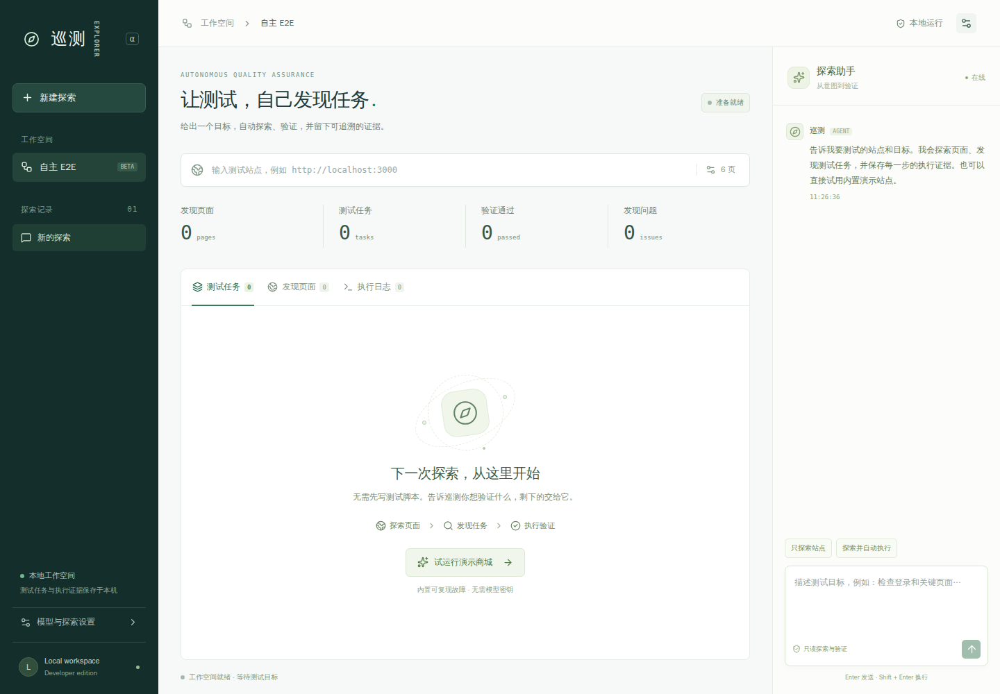
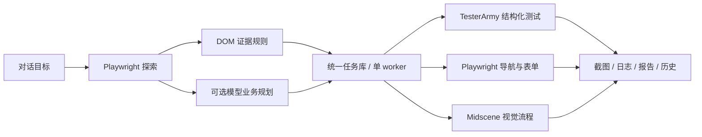

# Xunce（巡测）

通过对话发起测试，自动探索站点、发现任务并执行验证的Web 工具。

当前版本已打通：**输入目标 → 同源探索 → 自动生成测试任务 → 执行断言 → 查看截图/报告 → 失败复跑**。内置一个真实可访问的演示商城，其中故意保留了 HTTP 500 活动页，便于核验故障发现能力。



## 获取代码

```bash
git clone https://github.com/caoyanyi/xunce.git
cd xunce
```

## 启动

需要 Node.js **24.8+**。

```bash
npm ci
npm run browsers:install
npm run dev
```

打开 **http://127.0.0.1:5173**，点击“试运行演示商城”。无需配置模型密钥。已有系统 Chromium 时会自动使用，可省略浏览器安装；也可通过 `.env` 的 `CHROMIUM_PATH` 指定路径。

生产构建在同一个本地端口提供 API 和界面：

```bash
npm run build
npm start
```

打开 **http://127.0.0.1:4318**。默认监听 `0.0.0.0`，同一局域网设备可以访问 **`http://服务器局域网IP:4318`**；开发模式对应端口为 **5173**。

例如当前服务器地址为 `192.168.1.28`，可访问 `http://192.168.1.28:4318`。通过 `.env` 配置 `HOST` 和 `PORT`；设置 `HOST=127.0.0.1` 可恢复仅本机访问。开发代理会读取同一份端口配置。

服务接受任意 IP、域名和网段的连接，写请求保留同源 Origin 校验，支持反向代理后的 HTTP/HTTPS 访问。内置演示任务由服务器执行，因此演示目标使用服务器的 `127.0.0.1` 地址，远程浏览器不需要另起演示服务。

## Docker 编译与部署

在项目目录运行：

```bash
docker compose up -d --build
```

默认将容器 **4318** 端口发布到宿主机所有网卡，访问 **`http://服务器IP:4318`**。应用不限制访问者网段或请求域名。镜像通过多阶段构建编译 Web 和服务端，运行时使用 Node.js 24、系统 Chromium 和中文字体，不依赖宿主机的 Node.js、浏览器或 `node_modules`。

Compose 使用具名卷 `e2e-explorer_explorer-data` 持久保存 `/app/data`，保留 SQLite、历史任务和截图/Trace，并以非 root 的 `node` 用户运行。新环境无需手动创建目录或调整权限。

从原来的本机 `./data` 首次迁移时，先停止 `npm start`，再在空数据卷上执行：

```bash
docker compose create explorer
docker compose run --rm --no-deps -v "$(pwd)/data:/source:ro" explorer \
  node -e "require('node:fs').cpSync('/source','/app/data',{recursive:true})"
docker compose up -d
```

迁移不会修改原来的 `./data`；后续容器数据保存在具名卷中。

```bash
# 查看运行状态与日志
docker compose ps
docker compose logs -f explorer

# 验收已启动的容器：真实运行两种执行器，核验故障证据；不调用模型
docker compose exec explorer npm run test:docker

# 更新源码后重新编译部署
docker compose up -d --build

# 停止；具名数据卷仍保留
docker compose down
```

修改外部端口，例如发布到 **8080**：

```bash
HTTP_PORT=8080 docker compose up -d --build
```

也可将 `HTTP_PORT=8080` 写入 `.env`。容器内部端口固定为 4318。验收脚本也可以通过宿主机的 `npm run test:docker` 调用。脚本会创建独立会话并保存三项执行记录（其中一项故意触发 HTTP 500）；自定义端口可使用 `SMOKE_URL=http://127.0.0.1:8080 npm run test:docker`。

已有 `.env` 会在启动时注入模型配置，文件和运行数据不会复制进镜像；没有 `.env` 也能直接启动演示。构建可通过 `NODE_IMAGE`、`NPM_REGISTRY` 和 `DEBIAN_MIRROR` 参数自定义基础镜像、npm 源与 Debian 镜像源。默认 Debian 镜像源为 `mirrors.aliyun.com`，仍使用 Debian 软件包签名校验。

Docker 中的测试浏览器运行在容器内：访问宿主机应用请使用 `http://host.docker.internal:应用端口` 或宿主机局域网 IP，其他 Compose 服务可用服务名访问。内置商城继续使用容器自己的 loopback，默认 TesterArmy 演示可以直接运行。非 loopback 的明文 HTTP 被测站点按下文说明选择 Playwright。

单独使用 Docker：

```bash
docker build -t e2e-explorer:local .
docker run -d --init --name e2e-explorer \
  -p 4318:4318 --shm-size=1g \
  -v e2e-explorer-data:/app/data \
  --add-host=host.docker.internal:host-gateway \
  e2e-explorer:local
```

## 已实现的功能

| 能力         | 当前行为                                                                             |
| ------------ | ------------------------------------------------------------------------------------ |
| 对话发起任务 | 输入 URL 和测试目标；支持仅探索、自动运行、状态查询、停止、失败复跑                  |
| 自主发现     | Playwright 同源 BFS，提取真实页面、链接、表单，支持页面和深度预算                    |
| 确定性任务   | 页面 HTTP/标题/正文可用性、实际点击同源导航链接、原生表单必填约束                    |
| 业务任务规划 | 可选 OpenAI-compatible 模型根据页面观察与用户目标规划结构化视觉任务                  |
| 结构化执行   | 默认通过 TesterArmy 官方 `e2e/runner` 执行固定模板生成的 TypeScript 测试，无模型调用 |
| 视觉执行     | Midscene `PlaywrightAgent.aiAct` / `aiAssert`，配置视觉模型后启用                    |
| 基线执行     | 直接 Playwright；导航与表单约束任务使用此适配器                                      |
| 任务管理     | 优先级、来源、执行器、状态、搜索和筛选；支持单任务/全部/失败任务运行                 |
| 执行证据     | 截图、步骤日志、trace、原始执行报告、生成的 TesterArmy 测试代码                      |
| 历史与恢复   | SQLite 保存会话和独立 run；复跑保留历史；重启将中断操作恢复为“已停止”                |
| Web 控制台   | 中文界面、对话面板、页面列表、任务详情、执行历史、JSON 报告下载、移动端布局          |
| API          | 界面核心操作均有 HTTP API，可对接 CLI、CI 或 agent                                   |

未配置模型时，平台明确使用 **DOM 规则发现**，不将规则匹配描述为模型推理。它能主动生成基础测试；复杂业务意图需要配置规划模型与视觉模型。

### 常用对话

```text
探索 http://localhost:3000，检查页面和登录表单并自动执行
只探索站点并发现可验证的任务
运行全部任务
状态
停止
复跑失败任务
查看失败任务
帮助
```

目标可在上方 URL 输入框设置，也可以包含在对话中。任务已建立后，更换目标需要新建探索，避免混用不同站点的测试资产。默认页面预算 6、最大深度 2，可在“探索设置”中调整。

## 执行器如何组合



两个框架通过平台的任务协议组合。TesterArmy 管结构化测试与断言，Midscene 管视觉业务步骤，平台管理任务发现、调度、状态和证据。

- **TesterArmy**：真正调用安装的 `e2e` runner，使用 `@e2e-dev/web` engine。每个 run 生成可查看的 `task.e2e.ts`，在独立子进程运行。只把校验后的数据写入固定测试模板，不执行模型返回的代码。关闭该框架的匿名遥测。
- **Midscene**：使用官方 SDK，独立浏览器 context，操作和断言传入取消信号。缺少配置时明确报错，不降级为伪通过。
- **Playwright**：负责无密钥基线、表单本地约束及同源导航。每个 run 保存 Playwright `trace.zip`，可以用 `npx playwright show-trace <文件>` 打开。
- TesterArmy 的 trace 使用其原生报告/trace 格式，详情页会链接实际生成的文件，不承诺它是 Playwright trace。

## 配置模型

复制示例配置并填写自己的服务端环境变量：

```bash
cp .env.example .env
```

```dotenv
# 业务任务规划：OpenAI-compatible Chat Completions
PLANNER_BASE_URL=https://api.openai.com/v1
PLANNER_MODEL=your-planning-model
PLANNER_API_KEY=your-key

# Midscene：使用供应商支持的视觉模型配置
MIDSCENE_MODEL_BASE_URL=https://your-provider.example/v1
MIDSCENE_MODEL_NAME=your-vision-model
MIDSCENE_MODEL_FAMILY=your-supported-model-family
MIDSCENE_MODEL_API_KEY=your-key
```

具体模型 family 和供应商参数参照 [Midscene 官方配置](https://midscenejs.com/model-common-config)。重启服务后可在“模型与探索设置”查看配置状态。密钥不传到 Web 界面、不写入 SQLite；`.env` 与运行数据均已加入 `.gitignore`。

两个模型配置齐备后，DOM 任务之外会生成最多 6 个业务任务。规划器输出必须是符合 schema 的 JSON，起始页面必须实际观察过，所有 URL 必须同源，任务必须有结果断言；无效规划会记录错误并保留 DOM 任务。

默认阻止 POST/PUT/DELETE 等请求，也禁止任意点击、填写或视觉操作。需要登录/搜索/填写等交互时，在发起探索前开启“允许交互与写操作”，并使用可回收的测试数据。开启后业务操作可能改变目标系统的数据。

模型调用会将页面观察或截图发送给所配置的供应商。只有自行配置并使用模型功能时才发生此类调用。

## 数据与 API

默认本地数据目录：

```text
data/
├── explorer.sqlite       # 会话、消息、页面、任务、run、事件
└── artifacts/
    └── <session-id>/
        ├── page-*.png    # 探索证据
        └── <run-id>/     # 单次执行截图、trace、报告、测试代码
```

通过 `DATA_DIR` 自定义位置。已在运行的任务不能重复启动；服务关闭或取消时会收尾 browser/子进程并保留已完成结果。直接 Playwright/Midscene 任务预算 120 秒，TesterArmy 子进程预算 60 秒。

| 方法       | 路径                       | 用途                                 |
| ---------- | -------------------------- | ------------------------------------ |
| GET        | `/api/health`              | 服务健康状态                         |
| GET        | `/api/config`              | 模型配置布尔值与演示 URL，不返回密钥 |
| GET / POST | `/api/sessions`            | 列出/新建会话                        |
| GET        | `/api/sessions/:id`        | 完整会话快照                         |
| POST       | `/api/sessions/:id/chat`   | 对话指令与探索设置                   |
| POST       | `/api/sessions/:id/tasks`  | 创建经校验的结构化任务               |
| POST       | `/api/sessions/:id/run`    | 全部、指定任务或失败任务运行         |
| POST       | `/api/sessions/:id/cancel` | 停止当前操作                         |
| GET        | `/api/sessions/:id/report` | 下载包含任务和历史的 JSON 报告       |

例如，新建一个只使用 Playwright 的会话：

```bash
curl http://127.0.0.1:4318/api/sessions \
  -H 'Content-Type: application/json' \
  -d '{"targetUrl":"http://127.0.0.1:4318/demo","options":{"engine":"playwright","maxPages":6}}'
```

拿到返回的 `id` 后发起测试：

```bash
curl http://127.0.0.1:4318/api/sessions/<id>/chat \
  -H 'Content-Type: application/json' \
  -d '{"message":"探索商城并自动测试"}'
```

执行状态通过会话快照查询；Web 界面每 1.4 秒刷新。`run` 接受 `{"taskIds":["任务 UUID"]}` 或 `{"failedOnly":true}`。复跑会建立新 run，原证据保留。

## 验证

```bash
npm run typecheck
npm run lint
npm test
npm run test:e2e
npm audit
```

单元和集成测试覆盖执行边界、模型输出校验、SQLite 重启恢复、真实浏览器探索、表单断言、HTTP 故障、官方 TesterArmy runner、API 完整链路、并发锁、取消与复跑。UI E2E 覆盖从对话到任务结果、故障证据、复跑历史和移动端布局，并生成 `docs/screenshots/` 截图。

`npm run test:e2e` 会自动构建并启动独立的本地测试服务。测试只访问内置演示站点及本地模拟供应商，不调用用户模型。`npm run format` 格式化源码。当前 63 项单元/集成测试通过；另有 3 项界面 E2E 覆盖主流程。首版服务端及共享逻辑行覆盖率记录为 89.74%。详见 [验证记录](docs/verification.md)。

## 当前边界与后续规划

本版是单用户、共享工作空间的开发工具，支持所有网卡、网段和域名访问，适合已授权的开发/内测环境。没有多租户认证或独立 worker 网络沙箱。导航同源检查、URL 校验、跨站写请求拒绝和请求方法约束已实现；它们不能替代公网部署所需的鉴权和容器隔离。

- **复杂应用**：BFS 依赖可见链接和原生表单；登录后的隐藏页面、canvas、复杂 SPA、跨域 SSO 需要后续的认证状态和更强探索策略。表单任务验证浏览器原生必填约束，不代表已经验证业务登录逻辑。
- **内网 HTTP**：TesterArmy 当前上游配置对非 loopback 的明文 HTTP 地址有限制；此类内测站点请使用 Playwright 执行器，或配置 HTTPS。
- **视觉能力验证**：已对照官方类型接入 SDK 并验证模块可加载；真实模型业务效果需在填写供应商配置后验证，首版自动测试不消耗模型额度。
- **分布式能力**：当前单进程、单 worker，不支持水平扩容。并发、定时、任务资产评审、跨浏览器和大规模运行留在后续规划。
- **依赖**：锁文件固定版本；为 Midscene 的传递依赖设置了安全版本 overrides，当前 `npm audit` 无已知漏洞。Playwright 集成已验证，Puppeteer 模式未开放。

详细的产品范围、架构、实施单元与后续演进见 [功能与技术规划](docs/plans/2026-10-21-001-feat-conversational-e2e-platform-plan.md)。后续优先推进：认证状态与秘密引用 → 容器 worker/RBAC → 业务覆盖图与任务评审 → CI/定时 → 视觉差异、无障碍审计、失败聚类。

## 参考与许可

按指定地址调研：

- [tester-army/e2e](https://githubfast.com/tester-army/e2e)：实际使用 npm `e2e` 与 `@e2e-dev/web`，上游 Apache-2.0。
- [Midscene.js](https://githubfast.com/web-infra-dev/midscene)：实际使用 npm `@midscene/web`，上游 MIT。
- [autonomous-qa-agent](https://githubfast.com/iklymchuk/autonomous-qa-agent)：参考 BFS、用户流发现与证据报告思路；没有复制或执行其 Python 源码。

平台代码独立实现；上游依赖保留各自许可。
