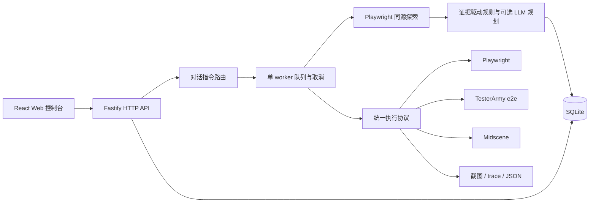

# 对话式自主 E2E 测试平台

## 目标与范围

用户输入站点地址和测试意图，平台自行探索页面，识别可验证的用户任务，建立任务清单并自动执行；用户通过 Web 控制台查看探索进度、测试步骤、失败原因、截图、trace，选择任务复跑。首版面向开发者在本机测试已授权的开发/内测环境，单用户、单 worker，不依赖云端服务。

验收闭环：启动平台 → 使用内置演示商城 → 对话要求探索和测试 → 自动发现真实页面和表单 → 执行任务 → 定位演示中的故障页面 → 查看证据 → 复跑任务。无模型密钥也能完成此流程；配置模型后启用意图推理及 Midscene 视觉任务。

## 参考项目与复用决策

调研来源（2026-10-21）：

| 项目                                                                        | 已确认能力                                                                                                          | 采用方式                                                                                                 |
| --------------------------------------------------------------------------- | ------------------------------------------------------------------------------------------------------------------- | -------------------------------------------------------------------------------------------------------- |
| [tester-army/e2e](https://githubfast.com/tester-army/e2e)                   | TypeScript `test`/`expect`、结构化 runner、Web engine、agent 步骤、断言后缓存重放；npm 包为 `e2e` 和 `@e2e-dev/web` | 独立执行适配器，生成可审计测试文件，运行已安装的本地 CLI，解析机器可读结果。禁止执行模型生成的任意代码。 |
| [Midscene.js](https://githubfast.com/web-infra-dev/midscene)                | `PlaywrightAgent`、`aiAct`/`aiAssert`、视觉定位、HTML 报告                                                          | 独立视觉执行适配器，使用官方 SDK 与隔离 browser context；密钥只从环境读取。                              |
| [autonomous-qa-agent](https://githubfast.com/iklymchuk/autonomous-qa-agent) | 同源 BFS、DOM 提取、用户流推理、优先级、失败分类、截图/trace                                                        | 借鉴“观察→发现→规划→执行→证据”的循环，平台自己实现任务、状态和控制台；不直接运行其生成的 Python。        |

两个执行项目都有 agent 能力，并非必须嵌套；平台用统一 Task/Step/Result 协议组合各自优势。确定性的 smoke/navigation/form-validation 任务走结构化执行；需要截图语义的多步业务流走 Midscene。首版保留直接 Playwright 执行作为无模型的确定性基线及探索引擎，执行器身份必须真实展示。

## 核心产品能力

1. 对话会话：记录用户目标，支持探索并自动运行、仅探索、状态查询、停止、失败复跑。
2. 自主任务发现：有页面/深度预算的同源 BFS；提取标题、主内容、链接、表单、按钮；基于证据生成任务、优先级和可执行断言；可选 OpenAI-compatible planner 增补视觉业务任务。
3. 任务管理：任务来源、类型、步骤、优先级、风险、状态、历史 run；一次只运行一个任务，停止信号贯穿探索和执行；重启恢复中断状态。
4. 统一执行：Playwright、TesterArmy e2e、Midscene 三个适配器；结构化步骤必须校验；自然语言业务动作受显式写操作开关约束，默认只执行读取和表单本地校验。
5. 证据：步骤事件、错误信息、截图、Playwright trace、JSON 报告与 TesterArmy 测试导出；结果持久保存。
6. 控制台：中文桌面优先响应式界面；会话/任务列表、目标输入、执行时间线、页面拓扑列表、任务详情及截图；加载、空、错误状态完整。

## 架构

以下结构用于表达组件边界，是方向性设计，不是必须逐字实现的代码。

采用 Node.js 24 + TypeScript、Fastify、SQLite（`node:sqlite`）、React/Vite。避免首版引入 Redis/PostgreSQL 等运维依赖。开发端口 Web 5173 / API 4318；生产构建由 API 同源托管。HTTP API 与界面能力对等，方便未来 CLI/MCP 接入。

## 实施单元

### U1 — 数据契约、持久化与执行边界

文件：`shared/types.ts`、`server/store.ts`、`server/policy.ts`；测试：`tests/store.test.ts`、`tests/policy.test.ts`。

会话、消息、页面观察、任务、run、事件持久化；所有 API 输入以 Zod 校验；任务状态通过服务层更新，run 是不可覆盖历史。目标限制 HTTP(S)、禁止 URL 凭据、爬虫仅同源导航、浏览器隔离、预算与超时。服务绑定 loopback；阻止跨站写请求和不可信 Host。首版不向公网开放。

测试：空数据库、重开后的历史、重启中断恢复；URL 协议/凭据/跨域拒绝；去重；非法步骤与写操作拒绝。

### U2 — 探索与任务发现

文件：`server/browser.ts`、`server/discovery.ts`、`server/planner.ts`；测试：`tests/discovery.test.ts`、`tests/planner.test.ts`。

BFS 按 URL 去重，限制页面数和深度；每页保存链接/表单和错误状态；生成可复现 smoke/navigation/required-field-validation 任务。可选模型使用受限结构化 JSON，校验来源 URL、动作、任务数量；页面内容作为不可信数据处理。没有配置时规则发现有明确标签；不伪装模型推理。

测试：同源遍历与预算、循环链接、404、取消、空站点；生成任务包含真实断言；模型畸形响应与越界 URL 拒绝。

### U3 — 执行器、worker 与证据

文件：`server/executors.ts`、`server/orchestrator.ts`、`server/tester-army.ts`；测试：`tests/executors.test.ts`、`tests/orchestrator.test.ts`。

任务逐个执行并持久化结果；实际验证 HTTP、页面内容与表单约束。失败保留截图与 trace；超时和取消关闭 context/child process；同一会话重复提交运行返回冲突；复跑产生新 run，不擦除旧 run。TesterArmy 使用固定模板生成代码、进程参数数组、无 shell；Midscene 未配置时拒绝并给出明确配置提示，不能假装通过。

测试：通过/失败/取消、未知执行器、无 Midscene 配置、TesterArmy 真正启动并有结果、复跑历史保留、并发锁、重启状态恢复。

### U4 — API、对话与本地演示站点

文件：`server/app.ts`、`server/index.ts`、`server/demo.ts`；测试：`tests/api.test.ts`。

会话 CRUD（新建、列表、读取）、chat、run/retry/cancel、任务详情、证据下载、配置状态与报告导出。对话首先匹配明确命令，常规目标触发发现；支持 URL 从目标输入或对话提取。提供包含导航、登录表单和故障页的本地演示商城。

测试：请求校验、404、跨站请求、凭据不泄漏、完整发现/执行/报告调用链。

### U5 — Web 控制台与使用文档

文件：`web/App.tsx`、`web/styles.css`、`web/main.tsx`、`README.md`、`.env.example`；测试：`tests/ui.e2e.ts`。

视觉方向：浅色工作台，深色侧栏，蓝绿色执行状态；内容按目标输入→探索/执行→任务证据组织。状态更新用短轮询，保留取消和错误反馈；任务行展开详情，截图可打开，报告可下载。加载淡入、运行状态和侧栏切换只使用必要动画，尊重 reduced-motion。

测试：无密钥完整用户流程，真实浏览器展示任务/结果/错误/截图；移动端无横向溢出；构建、类型、lint、单元与集成测试。

依赖顺序：U1 → U2 → U3 → U4 → U5。按上述单元在主线程顺序实现，避免并行修改。

## 后续演进

首版之后：多租户/RBAC、独立容器 worker、加密认证状态和秘密引用、覆盖图与任务资产评审、定时/CI、基线截图差异、axe 无障碍审计、跨浏览器、失败聚类及修复建议。它们在功能规划中保留，首版不宣称已实现。

## 已知边界与验证策略

- 规则探索只可见链接可达页面与原生表单；登录后隐藏功能、canvas、复杂 SPA 要配置凭据/视觉模型及更强探索策略。
- 内测站点可能在私网，允许本机明确提交的目标；同源约束限制导航但不等于容器网络隔离，公网部署必须先加入认证、网络 allowlist 与独立 worker。
- 模型/视觉 API 调用需用户自行配置 provider 与 key；开发验证只访问内置站点，不消耗用户模型额度。
- npm 依赖锁定后读取实际发布包文档与类型确认适配；若官方版本接口不同，在执行时调整实现并记录真实验证结果。
