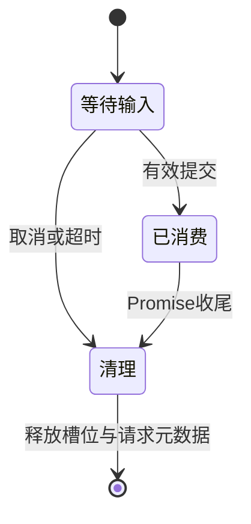
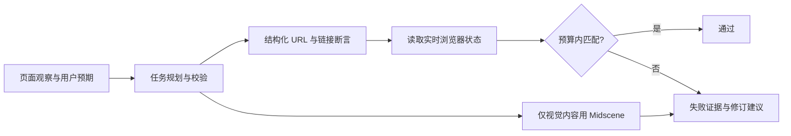

# 0.2 功能升级验收

初次验收日期：2026-10-21。范围：[功能升级计划](plans/2026-10-21-002-feat-usability-upgrade-plan.md)。下方交付、自动化和部署结果保留该日的历史记录；2026-10-23 的后续实测分为[验证码生命周期复验](#2026-10-23-验证码生命周期复验)和本轮[严格 URL 与链接断言验收](#2026-10-23-严格-url-与链接断言验收)，不将旧的 Docker 或部署结果作为本轮验证。

## 交付功能

| 能力         | 验证结果                                                                                                 |
| ------------ | -------------------------------------------------------------------------------------------------------- |
| 对话分流     | 提问、问候、失败解释不启动浏览器或模型；重新规划、继续、复跑各自有明确语义；控制命令不覆盖会话名称和目标 |
| 任务资产     | 新建、结构化步骤编辑、添加/排序、任务版本、启停、归档及恢复；旧运行保存当时的任务定义                    |
| 规划替换     | 旧自动任务归档，手工和已自定义任务保留；用户归档的任务不被自动恢复；规划失败保留旧视觉资产并显示警告     |
| 执行队列     | 跨会话 FIFO、同会话去重、取消排队、单 worker、停止后继续待执行/中断任务；每作业独立计数                  |
| 设置与预检   | 独立保存名称/选项；部分更新不重置其他字段；只读允许保存交互草稿，运行前检查权限、模型及执行器            |
| 结果与恢复   | 失败步骤和建议、本次进度、历史作业、旧版本定义；预检错误在任务抽屉内可见；重启恢复计数并取消未完成作业   |
| 浏览器与网络 | 保留验证码人工接续、同源限制及新标签页支持；修正同地址弹窗竞争；LAN HTTP 规则任务选择兼容执行器          |

## 自动化结果

| 检查                    | 结果                                                                                                 |
| ----------------------- | ---------------------------------------------------------------------------------------------------- |
| 单元/集成测试           | 135 / 135，通过 15 个测试文件                                                                        |
| 浏览器 E2E              | 9 / 9，通过桌面和移动端流程                                                                          |
| TypeScript / ESLint     | 通过                                                                                                 |
| 前后端生产构建          | 通过                                                                                                 |
| npm audit               | 0 个已知漏洞，使用 registry.npmjs.org 审计接口                                                       |
| Docker 多阶段构建       | 通过，运行包版本 0.2.0                                                                               |
| 独立容器 API/浏览器验证 | 部分设置、无作业问答、FIFO、Chromium 执行、作业计数、版本快照、停用预检、归档恢复、worker 收尾均通过 |
| Docker 官方执行器验证   | TesterArmy、Playwright、预期 HTTP 500、截图和报告均通过；使用独立内存数据库                          |

测试命令：

```bash
PLANNER_API_KEY='' MIDSCENE_MODEL_API_KEY='' npm test
PLANNER_API_KEY='' MIDSCENE_MODEL_API_KEY='' npm run test:e2e
npm run typecheck
npm run lint
npm run build
npm audit --registry=https://registry.npmjs.org
docker compose build
```

浏览器覆盖的实际链路包括：保存设置 → 新建任务 → 选择部分任务执行 → 编辑断言、添加和排序步骤 → 验证新版运行 → 查看旧版定义 → 复跑自动选最新记录 → 全部归档后恢复。另验证排队取消与复跑、验证码输错后的接续、只读预检错误可见，以及移动端长表单中的添加步骤与固定保存栏。

验证码测试使用应用自有的固定测试值；视觉调用替换为本地 SDK 边界模拟。测试未使用真实账号或付费模型，因此不将这些结果作为真实模型业务成功率的证明。

## 数据兼容与部署

作业复用现有 SQLite JSON 记录表，新增 `jobs` 记录类型，无破坏性 SQL 迁移。旧任务缺少版本号时按 v1 显示；没有历史定义快照的旧运行保持原样，不伪造快照。归档和停用均不删除记录。服务重启会取消排队/执行中的作业，不自动恢复写操作。

部署前确认服务没有活动或排队作业。更新后通过局域网地址 `http://192.168.1.28:4318` 验证健康接口、全局运行态与新前端资源；逐一比对旧记录 ID，保留 **10 个会话、39 个任务、71 条运行记录**及原有消息/事件。数据卷未替换。容器版本 **0.2.0**，健康状态 `healthy`，自动重启次数 **0**。

独立容器验证使用内存数据库和临时 artifacts，模型密钥以空值覆盖，没有向正式数据卷添加测试作业。保留了本地旧镜像 `e2e-explorer:pre-0.2.0` 供故障定位；旧版本不理解新增的任务启停/归档语义，不应使用旧版本继续执行 0.2 的任务数据。

## 复查与可视验证

按项目要求在主线程顺序复查正确性、接口契约、数据完整性、异步收尾、权限、性能与测试。已处理：Zod 部分更新默认值覆盖、全部归档后入口消失、预检错误被抽屉遮挡、重启计数窗口、同地址新标签页竞争、无必要的客户端校验依赖，以及长步骤表单的滚动区被底栏遮挡。剩余需处理项：无。

前端共享运行时与校验 schema 分离；生产 JavaScript 为 274.05 kB（gzip 85.86 kB）。桌面和移动端截图均使用本地测试数据：

- [工作台](screenshots/workspace-upgrade.png)
- [任务编辑器](screenshots/task-editor.png)
- [移动端编辑器](screenshots/task-editor-mobile.png)

## 部署后观察

本次部署由当前开发代理执行验证：健康接口成功、`/api/runtime` 无遗留活动作业/队列、旧记录完整、新静态资源可访问。后续运行时应观察作业计数是否推进、取消后 worker 是否释放，以及容器重启次数是否增长。服务日志重点检查 `Frame for this navigation request`、未处理异常和持续 HTTP 500。若发生异常，先停止对应作业并保留 trace，按记录中的失败步骤修订或修复服务；不自动重试写操作，也不覆盖数据卷。

## 2026-10-23 验证码生命周期复验

本轮仅修复验证码人工接续的等待竞态并补充回归，不扩展功能，不变更数据库、任务定义或 API 请求格式。

### 修复与回归

`ManualInputs.submit()` 原先在 Promise 完成清理前就释放等待槽位，同一轮调用中新建的等待可能被上一个等待的 `finally` 清除。此外，取消信号触发后、异步清理完成前，旧请求仍可能被接受。新增回归在修复前实际复现了这两个失败。

修复后同步标记请求已消费，保留原等待的所有权直到其 `finally` 清理；提交时同步校验取消信号，已消费、已取消、已过期或归属不符的请求均返回 409。人工输入只用于恢复当前等待，不写入消息或持久化记录。



等待槽位在清理完成前不可复用。`tests/manual-input.test.ts` 从 5 项增加到 10 项，新增覆盖：提交后的等待所有权、取消后立即提交、并发等待不影响原请求、预先取消不发布请求或分配定时器，以及到期但超时回调尚未执行的边界。

### 本轮实测结果

| 检查                                     | 2026-10-23 结果                                                                 |
| ---------------------------------------- | ------------------------------------------------------------------------------- |
| 单元/集成测试                            | **140 / 140**，15 个文件全部通过；包含真实浏览器发现、执行及验证码人工接续测试  |
| 界面 E2E                                 | **9 / 9**，包含验证码输入时刷新控制台后恢复同一运行，以及桌面和移动端任务工作流 |
| TypeScript / ESLint                      | 通过                                                                            |
| 本轮修改的 TypeScript 文件 Prettier 检查 | 通过                                                                            |
| 前后端生产构建                           | `vite build`、`tsc -p tsconfig.server.json` 通过；类型检查单独执行通过          |
| npm audit                                | **0 个已知漏洞**，使用 `https://registry.npmjs.org`                             |
| Docker / 容器部署                        | **未重跑**；当前环境无 `docker.exe`，上文结果仅为 2026-10-21 历史记录           |
| 覆盖率                                   | **未重测**；首版 89.74% 仅为历史记录                                            |

### 执行环境与复现

当前 Windows 环境的系统 Node 为 v22，项目要求 Node >=24.8.0。本轮通过本地临时 Node 24 运行 CLI，测试包装脚本将该运行时加入子进程 `PATH`，清空 `PLANNER_API_KEY`、`MIDSCENE_MODEL_API_KEY`，并通过 `CHROMIUM_PATH` 使用已安装的 Google Chrome。未依赖 Playwright Chromium 下载，收尾时已停止该未完成的后台下载进程。`data/` 下的临时运行时及包装脚本被 Git 忽略，不属于交付源码。

本轮两套测试的实际入口：

```text
node.exe data/verify.cjs node_modules/vitest/vitest.mjs run
node.exe data/verify.cjs node_modules/playwright/cli.js test
```

在满足项目 Node 版本及浏览器依赖的环境中，可使用上文标准 `npm` 命令复现；Windows 可在 PowerShell 中设置 `CHROMIUM_PATH` 为本机 Chrome 可执行文件，并显式清空两个模型密钥后运行。界面测试使用独立测试服务和数据目录，没有向正式部署数据卷添加测试记录。测试生成的文档截图已恢复，未以本轮临时图片覆盖交付截图。

本轮未调用付费模型；Midscene 仍是本地模拟的 SDK 合同验证，不能据此声称真实视觉模型效果已验收。验证码仍需用户人工输入，不提供识别、猜测或绕过能力。依赖审计及界面测试中的旧 npm 用户配置、颜色环境变量警告未导致检查失败。本节为代码提交前的验证记录，不包含其他设备上的生产部署验收。

## 2026-10-23 严格 URL 与链接断言验收

本轮针对两类真实反馈迭代：`assertUrl` 固定 5 秒等待及 `DOMContentLoaded` 条件不能可靠表达延迟 SPA 地址变化；`aiAssert` 从截图无法确定条款链接的 href。目标是使用可复核的浏览器证据，而不是延长固定休眠、猜测链接目标，或放宽预期来让任务通过。

### 交付语义与兼容性

| 范围         | 本轮行为                                                                                                                                                          |
| ------------ | ----------------------------------------------------------------------------------------------------------------------------------------------------------------- |
| `assertUrl`  | 默认 `exact`，以标准 `URL` 规范化后的完整地址比较，query/hash 不被忽略；显式 `path` 只比较 origin 与 pathname，仍区分大小写、尾斜线及子路径                       |
| `assertLink` | 轮询全部可见 `<a href>`，比较解析后的完整 href；可选文本按空白归一后的子串匹配，必须属于同一个元素；只检查、不点击                                                |
| 等待与中断   | 两种断言默认 10 秒，`timeoutMs` 为 100–30000 的整数；不要求新的 `DOMContentLoaded`；取消、关闭、崩溃保留原始错误而非伪装成 mismatch                               |
| 失败证据     | 记录预期/实际 URL、失败步骤、模式和等待时间；链接证据最多 40 条配对记录，带 `linksTruncated`；区分未采集与空列表，截图和 Trace 按可用性保留                       |
| TesterArmy   | 固定模板使用相同匹配探针，失败 sidecar 合并进运行证据；总预算覆盖所有步骤，不再让单个 30 秒断言与原 30 秒 runner 总预算冲突                                       |
| 规划分流     | 结构化任务使用 Playwright，只含结构化步骤时不要求配置 Midscene；只有视觉步骤才使用 Midscene；明确的 URL/href 检查若放入 `aiAssert` 则拒绝该规划，不猜测或改写目标 |
| 控制台       | 可编辑并保存匹配模式、等待时间及可选链接文本；失败详情展示严格语义和文本/href 配对证据，提示列表截断                                                              |



匹配前不截断地址或文本；持久化链接证据的文本/地址分别限 500/4096 字符。40 条仅为证据上限，不是扫描上限。`linksTruncated: true` 时未列出的链接不能认定为不存在；视觉上下文也收到这个边界提示。

新增字段均为可选，旧 `assertUrl` / `assertLink` 定义仍可读取，但旧链接断言不再忽略 hash，默认等待改为 10 秒。已有 `aiAssert` 任务不自动迁移或改写：应编辑为结构化断言，或重新规划；纯文本/页面视觉检查可以保留。数据库无需破坏性 SQL 迁移，历史运行证据不会被补造。登录后的验证仍须与登录动作位于同一任务，不保证错误预期或未完成登录能够通过。

### 本轮实测结果

| 检查                       | 结果                                                                                                                            |
| -------------------------- | ------------------------------------------------------------------------------------------------------------------------------- |
| 全部 Vitest 单元/集成测试  | **228 / 228，17 个文件通过**；含真实 Chromium、官方 TesterArmy runner 及本地模拟的模型合同                                      |
| 浏览器探针修复后的定向回归 | **72 / 72，4 个文件通过**：`browser-assertions`、`tester-army-assertions`、`page-state`、`midscene`                             |
| 最终规划能力与提示回归     | **59 / 59，2 个文件通过**：`usability`、`planner`；含新增的 2 项规划/Midscene 配置组合回归，未重复全量测试                     |
| 完整 UI E2E                | **13 / 13 通过**；新增断言参数保存/刷新、URL 失败、配对链接截断证据、空列表与未采集状态；原验证码、排队、修订和移动端流程仍通过 |
| 最终类型检查 / ESLint      | `tsc --noEmit`、`eslint .` 通过                                                                                                 |
| 最终前后端生产构建         | `vite build`、`tsc -p tsconfig.server.json` 通过；最终浏览器探针修复已包含在构建内                                              |
| 修改源码格式               | Prettier 格式化及后续检查；除排版外不改动已测逻辑                                                                               |
| 依赖、Docker、其他设备部署 | 本轮未更新依赖，**未重跑 audit、Docker 或其他设备部署**                                                                         |
| 真实站点/付费模型、覆盖率  | **未验收**；用户反馈的外部站点未作为本轮在线测试目标；不声称实际账号登录成功或模型业务成功率                                    |

全量 Vitest 先通过；首次 UI 回归发现 `tsx` 的 keep-names 转换在浏览器探针的局部函数上引入了 `__name`，序列化进入页面后不可用。已将文本归一化改成内联表达式，随后 72 项受影响测试与完整 13 项 UI 均通过。UI 使用实际 `tsx` 服务入口，覆盖了单纯编译测试未暴露的路径；最终静态检查和生产构建在该修复之后执行。没有重复跑完已通过的全量 Vitest，也没有把定向 72 项当作额外独立测试总数。

最后的定向回归还验证：仅有规划模型、无 Midscene 时仍可生成并通过 Playwright 执行结构化任务，配置提示不再误称“仅检查基础页面”；无规划模型时准确提示 DOM 规则发现。最后这 2 项新增回归使当前测试定义总数为 230 项；本轮全量实测仍按此前的 228 项记录，不把定向 59 项与全量或 72 项相加。

回归还验证：超过 5 秒的 SPA URL 变化，无新 `DOMContentLoaded`；query/hash 严格不匹配；同源路径的 scheme/host/port、大小写、尾斜线及子路径边界；延迟可见且位于第 40 个之后的相对链接；拒绝隐藏链接或不同元素的文本/href 拼接；真实 CDP renderer crash、页面关闭和取消不被标为 mismatch；TesterArmy sidecar 正确合并失败步骤和浏览器证据。

### 环境与复现

沿用上节 Node 24 包装脚本和本机 Chrome，显式清空两个模型密钥；未读取或修改 `.env`。正常环境可使用 `npm test`、`npm run test:e2e`、`npm run typecheck`、`npm run lint` 和 `npm run build`。定向复验入口如下：

```text
node.exe data/verify.cjs node_modules/vitest/vitest.mjs run tests/browser-assertions.test.ts tests/tester-army-assertions.test.ts tests/page-state.test.ts tests/midscene.test.ts
node.exe data/verify.cjs node_modules/vitest/vitest.mjs run tests/usability.test.ts tests/planner.test.ts
node.exe data/verify.cjs node_modules/playwright/cli.js test
```

测试服务和数据目录独立，没有向正式数据卷添加记录。UI 生成的 7 张临时文档截图已恢复，不混入源码提交。原 npm 用户镜像配置及 `NO_COLOR` 警告未导致测试失败。`data/` 内的包装脚本和测试输出均被忽略，不属于交付文件。

本节为提交前的验证记录。其他设备更新时保留原 `.env` 与数据卷，拉取后重新构建容器；不要执行 `docker compose down -v`。旧记录保留不等同于旧任务的错误预期被自动修复，更新后应按上述语义修订或重新规划对应任务。
